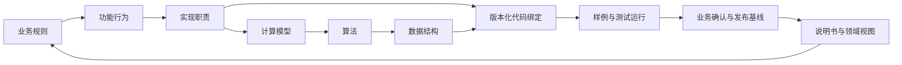

# 业务与实现一体化：可版本化能力单元

状态：设计提案，尚未实现引擎扩展。本阶段只建立独立工程与操作流程。
本方案从 XCS 会话的 2026-11-07 设计讨论提炼，可独立用于任意软件项目，
不要求 XCS/XAPS 运行时、APS 输入模型或特定实现语言。

以“可独立验收的能力/规则簇”为组织单位，关联业务、实现、样例与证据。
Git 固定版本，CodeGraph 提供代码结构，CM 连接澄清、取舍与经验；
仓库保存可审阅合同，测试与业务确认提供证据，出版层按基线生成说明书。
同一能力不必拆成六份文件，简单能力可以说明某层不适用。

## 六种视图与三条轴

| 视图 | 核心问题 | 最小内容 |
|---|---|---|
| B 业务规则 | 谁在什么条件下需要什么结果 | 原始来源、范围、术语、规则、例外 |
| F 功能行为 | 系统提供哪些可观察行为 | 输入输出、状态、异常、验收场景 |
| R 实现职责 | 谁负责、如何协作 | 模块、接口、数据流、事务和替换边界 |
| C 计算模型 | 如何形式化行为 | 变量、单位、不变量、约束、目标 |
| A 算法 | 如何执行或求解 | 步骤、正确性义务、复杂度与退化行为 |
| D 数据结构 | 状态如何表示 | 类型、身份、所有权、索引、生命周期 |

纵向是六视图；横向是自行登记的领域；时间轴是需求、实现、验证、发布与反馈。
应用/客户范围与读者角色是独立选择条件。业务模型可由 B/F 共享；“功能实现”
首先表示逻辑职责设计，代码制品绑定多层，不要求先写代码再补形式化解释。
XAPS 已有人工作业的四层组织仍按其自身合同执行，不批量改标为六层。

## 正向设计与逆向学习

正向从场景逐层产生实现义务；逆向从固定 commit 的代码、配置、接口、
测试定义和历史材料建立 F/R 到实现的关系，再由人工校准并补充 B。
业务目的未知时留空，不能从函数名自动推导已确认需求。

分别保存 `as_is` 现状与 `to_be` 目标。代码做什么、测试声明什么、某次运行
输出什么、业务要求什么是四种来源；人工可将现状判为合同、缺陷、兼容例外
或待澄清。确认目标后进入同一变更流程，不把逆向文档自动变成产品承诺。
本仓库 [首轮计划](reverse-pilot.md) 尚未执行。

## 对象与关系

最小对象：Capability/Artifact、不可变 ArtifactRevision、Relation、
Question/Decision、CodeBinding、Scenario/Example、TestSpecification、
TestRun/Evidence、ChangeSet/Baseline、ViewSpec/KnowledgePackage、Release。
可共享对象表与类型注册表，不必各建一个服务。

- 逻辑 ID 稳定，修订 ID 和内容摘要独立；文件名、行号、文本哈希不充当逻辑身份。
- 代码绑定含仓库身份、commit、路径、符号/签名、内容摘要、索引版本。
- Evidence 绑定被检验断言版本，以及输入、配置、工具链、命令和报告摘要。
  TestSpecification 与一次 TestRun 分开，旧测试运行不能自动证明新修订。
- 关系按语义区分 `refines/realizes/formalizes/implements/depends_on`、
  `derived_from/verified_by/contradicts`、`extends/specializes/overrides/`
  `supersedes/invalidates/retains_with_scope`。它们不等于经验关系 `caused`。
- 类型注册表约束端点、方向、防环及影响传播；调用图允许环，细化/替代链
  应防环。只让声明的依赖触发证据失效；未覆盖动态依赖标为 unknown。

治理 `proposed/accepted/rejected`、执行状态、知识生命周期、证据等级
分别记录。来源和人工确认不能被高置信度替代。元数据是主张，仍需核源。

## 覆盖、扩展与变更

基线固定模型、代码、输入/配置、样例和证据版本。覆盖是适用范围内的
显式替代；扩展保留基础合同并增加约束或行为。相同名字不意味同一范围，
禁止“最后写入获胜”自动解决客户/版本冲突。选择规则须确定且可解释，
同优先级冲突交由人工裁定。

ChangeSet 带 expected revision、理由、范围和来源；检查并发冲突后
事务性发布修订及关系，保留历史和幂等回执。代码或需求改变使相关证据
标为 `needs_revalidation`，不自动宣布历史观察为假。
替换验证比较经确认的可观察合同：输入、输出、异常、确定性、精度、性能
及生命周期。仅有算法输出相似不足以证明可替换。

## 说明书、样例与裁剪

`memory/INDEX.md` 作为统一入口，提供功能目录、领域目录和样例入口。
每个样例有 ID、前提、步骤、输入、预期、实际运行证据与适用版本；
区分示意样例和已验证样例。说明书链接到功能及样例，不暴露无关实现细节。

| 视图 | 选择条件 | 输出 |
|---|---|---|
| 功能说明书 | layers=B,F,R | 业务规则、可观察行为、职责与样例 |
| APS 领域说明 | domain=xaps，加所需 layers | APS 能力及共享依赖声明 |
| 仿真领域说明 | domain=des，加所需 layers | 仿真能力及共享依赖声明 |
| CM 功能说明 | domain=cm.product | 事实生命周期、检索等经确认能力 |

裁剪是基线上的投影，默认不删除源知识。选择领域/层次后，按视图策略
显式加入必要依赖，或生成带版本的外部引用/缺口；不静默留下悬空边。
manifest 记录源 baseline、选择器、实际对象修订、外部依赖、摘要及验证状态。
展示视图可以隐藏底层细节，但追溯包保留解析依据。导入需处理 ID 命名空间、
重复、冲突、完整性和版本兼容；当前 CM 搜索 top-K 或导出格式不能充当闭包。
受众裁剪不等于访问控制；若涉及权限，需要独立的安全模型。

## 是否扩充 CM 源码与接口

结论：试点可先用现有 CM + Git 文档做；可靠的一体化平台最终需要扩展。
建议将通用存储/查询能力放入 CM，可选工程层负责六视图、澄清、CodeGraph
绑定、验收与出版。保持现有事实/因果 API 的兼容性，避免将 APS 规则写入内核。

| 优先次序 | 候选扩展（尚未实现/定 API 名） | 先要验证的原因 |
|---|---|---|
| 1 | 结构化来源、范围、分区、稳定 ID 与可审计回执 | 文本 cm_meta 不支持精确过滤 |
| 2 | 修订、类型化关系与事务性 ChangeSet | 替换事实不等于范围化合同演进 |
| 3 | 精确 get/list/分页/过滤及完整关系遍历 | 相似检索不能证明全量或依赖闭包 |
| 4 | 代码/证据绑定、基线及影响失效 | 索引命中不能替代版本化验证 |
| 5 | 视图、知识包 manifest、完整导出导入与回滚 | 需先验证闭包、冲突和往返完整性 |

先跑受控逆向切片测量断链、陈旧证据、召回与人工校准成本，再选择最小缺口。
YantrikDB 与 three-tier 的可借鉴范围见 [评估](reference-assessment.md)。
需求到测试确认发布的人工步骤见 [交付流程](../../memory/workflows/delivery.md)。
